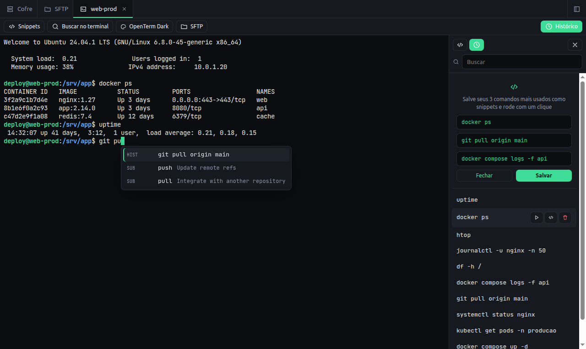
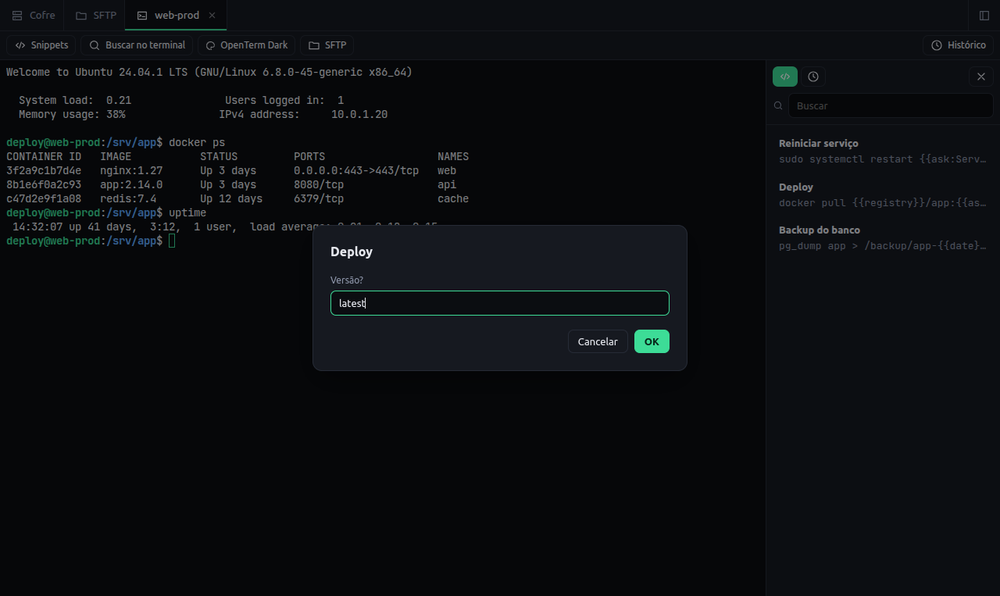
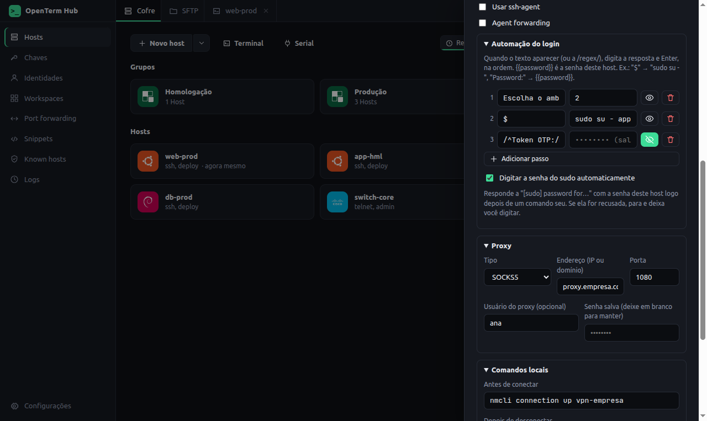
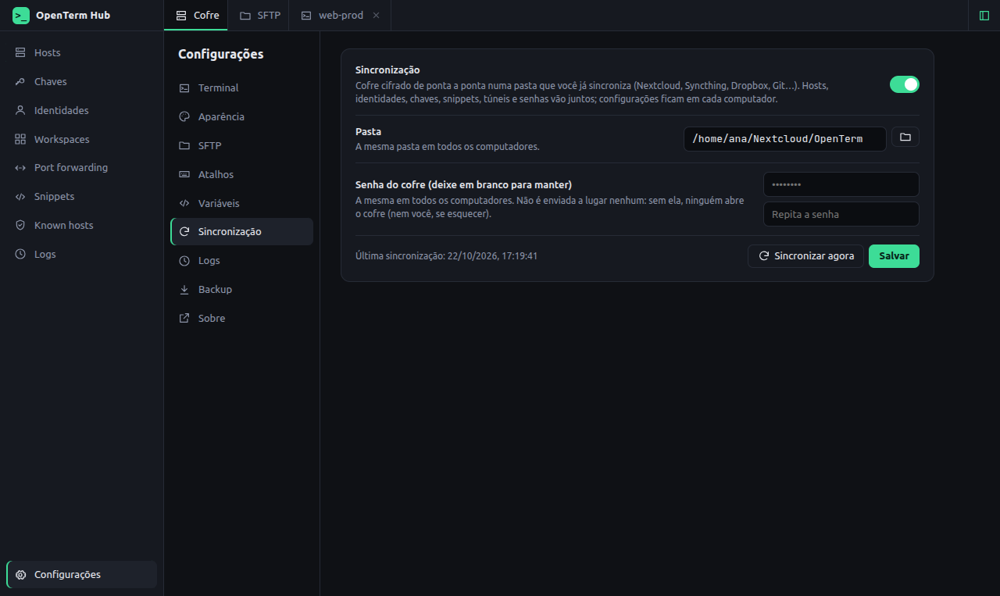
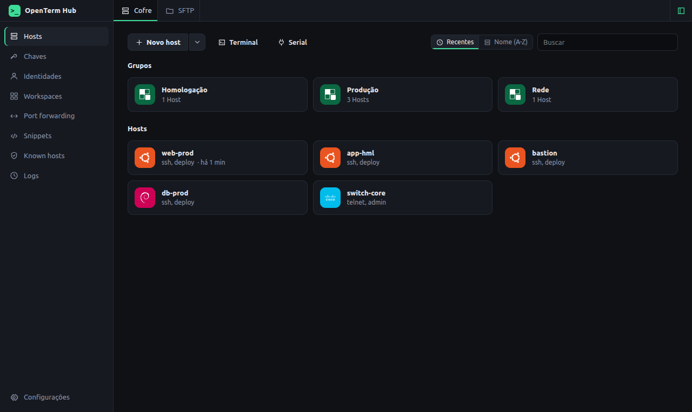

# OpenTerm Hub

[](https://github.com/sposito88/openterm-hub/releases/latest)
[](LICENSE)
[](#instalar)

Cliente SSH de desktop, open source (MIT), feito com Electron. Organiza seus hosts, abre terminais em abas, transfere arquivos por SFTP, cria túneis, sugere comandos enquanto você digita, automatiza o login e sincroniza seu cofre com criptografia de ponta a ponta.

*English summary at the end.*

## Instalar

**Linux e macOS:**

```bash
curl -fsSL https://raw.githubusercontent.com/sposito88/openterm-hub/main/install.sh | sh
```

**Windows (PowerShell):**

```powershell
irm https://raw.githubusercontent.com/sposito88/openterm-hub/main/install.ps1 | iex
```

O script baixa a versão mais recente para o seu sistema e **confere o SHA-256** de cada arquivo com o `SHA256SUMS.txt` do release antes de instalar:

- **Debian/Ubuntu:** instala o `.deb` (pede `sudo`).
- **Outras distros Linux:** instala o AppImage em `~/.local/bin`, sem `sudo`, com atalho no menu.
- **macOS:** coloca o app em `/Applications`.
- **Windows:** abre o instalador.

Prefere ler antes de rodar? Baixe o [install.sh](install.sh) ou o [install.ps1](install.ps1), confira e execute. Opções: `OPENTERM_VERSION=v0.3.7` (versão específica), `OPENTERM_APPIMAGE=1` (forçar o AppImage) e `OPENTERM_DRY_RUN=1` (só baixar e verificar).

### Download manual

Os instaladores ficam na página de [Releases](https://github.com/sposito88/openterm-hub/releases):

| Sistema | Arquivo |
|---|---|
| Windows | `openterm-hub-<versão>-setup-x64.exe` (instalador) ou `…-portable-x64.exe` (sem instalar). Também roda no Windows ARM por emulação. |
| macOS | `…-mac-arm64.dmg` (Apple Silicon) ou `…-mac-x64.dmg` (Intel) |
| Linux | `…-linux-amd64.deb` (Debian/Ubuntu) ou `…-linux-x86_64.AppImage`; em ARM64 (Raspberry Pi 4/5 com sistema 64 bits, notebooks ARM), `…-linux-arm64.deb` ou `…-linux-arm64.AppImage` |

Os binários ainda não são assinados. Na primeira execução:
- **Windows:** em "O Windows protegeu o computador", clique em *Mais informações → Executar assim mesmo*.
- **macOS:** clique com o botão direito no app e escolha *Abrir*.

Detalhes em [BUILDING.md](BUILDING.md).




## Funcionalidades

| Área | O que faz |
|---|---|
| **Hosts** | Cadastro com grupos, tags e busca. Protocolos SSH, Mosh e Telnet. Importa o `~/.ssh/config` (incluindo `IdentityFile` e `ProxyJump`). |
| **Terminal** | Abas com xterm.js, terminal local (seu shell), porta serial, busca no conteúdo, reconexão automática quando a conexão cai, selecionar para copiar e botão direito para colar, som de bell, tipo de emulação (`TERM`) configurável e 19 temas de cores (Dracula, Nord, Solarized, Gruvbox, Tokyo Night, Catppuccin, Kanagawa, Flexoki…). |
| **Identidades** | Um login (usuário, senha e/ou chave) salvo uma vez e reaproveitado em vários hosts. Trocou a senha, troca num lugar só. |
| **Workspaces** | Telas divididas (lado a lado ou empilhado) com redimensionamento, broadcast de comandos para múltiplos servidores simultâneos, maximizar painel e salvar o conjunto no cofre para reabrir com 1 clique. Arraste abas de terminal para fundir em um workspace. |
| **Autenticação** | Senha salva, chave privada, ssh-agent, keyboard-interactive (2FA/OTP), agent forwarding e jump hosts encadeados. **Chaves de segurança FIDO2** (YubiKey, SoloKey…) via ssh-agent, com aviso para tocar na chave. **Proxy SOCKS5 ou HTTP** por host, com usuário e senha opcionais. |
| **Automação do login** | **Sequências de login** por host: "quando aparecer X, digite Y" (texto ou `/regex/`), para `sudo su -`, menus de bastion e `enable` em switches; respostas secretas ficam cifradas. **Senha do sudo automática** (opcional por host): responde só depois de um comando que roda `sudo` e para se a senha for recusada. |
| **Comandos locais** | Por host, um comando que roda **neste computador** antes de conectar (subir a VPN, wake-on-LAN) e outro depois da última sessão fechar. Terminal, SFTP e túneis do mesmo host compartilham: fechar o SFTP não derruba a VPN do terminal. |
| **Segurança** | Confirmação da chave do servidor na primeira conexão, alerta quando ela muda e lista de *known hosts*. Segredos cifrados pelo chaveiro do sistema. |
| **SFTP** | Dois painéis, cada um apontando para este computador **ou qualquer host do cofre**: copie local↔servidor ou **direto de um servidor para outro**. Upload e download recursivos, progresso, nova pasta, renomear, excluir e arquivos ocultos opcionais. **Abrir com…**: edite um arquivo remoto no programa de sua escolha, e cada vez que salvar ele volta ao servidor. |
| **Port forwarding** | Túneis local (`-L`), remoto (`-R`) e dinâmico (`-D`, SOCKS5). |
| **Chaves** | Gera Ed25519, RSA e ECDSA (com passphrase opcional), importa, exporta e instala no servidor (equivalente ao `ssh-copy-id`). |
| **Snippets** | Comandos salvos para rodar em qualquer aba ou automaticamente ao conectar. **Variáveis**: `{{host}}`, `{{user}}`, `{{port}}`, `{{date}}`, variáveis globais e `{{ask:Pergunta=padrão}}`, que pergunta na hora. Textos como o `{{.Names}}` do docker ficam intactos. |
| **Sincronização** | Opcional: um cofre **cifrado de ponta a ponta** (AES-256-GCM, chave derivada da sua senha com scrypt) numa pasta que você já sincroniza (Nextcloud, Syncthing, Dropbox, Git…). Junta as mudanças item a item, respeita exclusões e aproveita as cópias de conflito das ferramentas de sync. A senha do cofre nunca sai do computador. |
| **Autocomplete** | Sugestões de comandos, subcomandos e opções (mais de 1400 ferramentas, via specs do [Fig](https://github.com/withfig/autocomplete)), do seu histórico, do histórico importado do bash/zsh/fish e dos snippets. Tab aceita, ↑/↓ navegam, Esc fecha. |
| **Histórico** | Painel ao lado do terminal com busca nos comandos já usados (neste app e no histórico do seu shell): clique para digitar, ▶ para executar, salve como snippet ou remova. Sugere salvar os 3 comandos mais usados como snippets. |
| **Logs** | Histórico de conexões (quando, para onde, duração e como terminou) e, se ativado, gravação da saída das sessões, que pode ser revista depois. |
| **Atalhos** | Todos configuráveis em Configurações → Atalhos: trocar de aba (Ctrl+1…9, Alt+←/→), fechar aba, copiar, colar, selecionar tudo, buscar, zoom da fonte, abrir terminal local, serial, SFTP, port forwarding, snippets e configurações. |
| **Migração** | Importa hosts, senhas, chaves, snippets e known hosts de um arquivo JSON documentado ([docs/IMPORT.md](docs/IMPORT.md)), além do `~/.ssh/config`. |
| **Outros** | Tema da interface escuro, claro ou do sistema; português e inglês; backup em JSON (sem segredos). |

## Em imagens

| | |
|---|---|
| <br>**Snippets com variáveis:** `{{ask:Versão?=latest}}` pergunta na hora; `{{registry}}` vem das variáveis globais. | <br>**Automação do login:** passos "quando aparecer X, digite Y", senha do sudo, proxy SOCKS5 e a VPN que sobe antes de conectar. |
| <br>**Sincronização cifrada:** o cofre vai para uma pasta que você já sincroniza; sem a senha, ninguém lê. | <br>**Cofre:** hosts em grupos, ícone do sistema detectado ao conectar e os mais recentes primeiro. |
| <br>**Chave do servidor:** confirmada na primeira conexão, com alerta se mudar. | <br>**Port forwarding:** túneis local, remoto e SOCKS5. |

## Rodar a partir do código

Requisitos: Node.js 22+ e git. No Linux também `build-essential` e `python3`, para compilar os módulos nativos. Windows e macOS usam binários prontos.

```bash
git clone https://github.com/sposito88/openterm-hub.git
cd openterm-hub
npm install        # também compila node-pty e serialport para o Electron
npm run dev        # modo desenvolvimento, com hot reload
```

Outros comandos:

```bash
npm test           # testes unitários e de integração (servidor SSH real em memória)
npm run typecheck  # checagem de tipos TypeScript
npm run build      # build de produção em out/
npm run dist       # Linux: .deb e AppImage em dist/
npm run dist:win   # Windows: instalador e portátil .exe (no Linux, só o portátil sem Wine)
npm run dist:mac   # macOS: .dmg e .zip (só num Mac; ou use o workflow de Release)
npm run notices    # regenera THIRD_PARTY_NOTICES.md
```

Para usar um perfil separado (útil em testes), defina `OPENTERM_DATA_DIR=/caminho/da/pasta`.

> **Mosh e Telnet** usam os binários `mosh` e `telnet` instalados no sistema. O Mosh autentica pelo `ssh` do sistema, ou seja, com o seu `~/.ssh`.

## Arquitetura

```
src/
  main/        processo principal (Node): SSH, SFTP, túneis, PTY, armazenamento
  preload/     ponte IPC mínima exposta à interface (contextBridge)
  renderer/    interface React + xterm.js (sandbox, sem acesso ao Node)
  shared/      tipos compartilhados e o contrato da API
test/          node:test, com um servidor ssh2 real no processo
```

- **SSH, SFTP e túneis:** [`ssh2`](https://github.com/mscdex/ssh2)
- **Terminal local:** [`node-pty`](https://github.com/microsoft/node-pty)
- **Porta serial:** [`serialport`](https://serialport.io)
- **Terminal:** [`xterm.js`](https://xtermjs.org)
- **Autocomplete:** [`@withfig/autocomplete`](https://github.com/withfig/autocomplete)

Os dados ficam na pasta de dados do app (no Linux, `~/.config/openterm-hub/`):
- `data.json`: hosts, chaves públicas, snippets, regras, known hosts, configurações e histórico;
- `secrets.json`: senhas e chaves privadas, cifradas com `safeStorage`;
- com a sincronização ativa, `openterm-hub-vault.json` na pasta escolhida (cifrado; sem a senha do cofre, ninguém lê).

Veja [SECURITY.md](SECURITY.md) para os detalhes de segurança.

## Roadmap

- Compartilhamento de hosts em equipe.
- Encoding, fonte e backspace por host; importadores do PuTTY, MobaXterm e mRemoteNG.
- Assinatura de código para Windows e notarização para macOS.
- Editor de arquivos remotos e arrastar e soltar no SFTP.

## Licença

[MIT](LICENSE). Os componentes de terceiros e suas licenças estão em [THIRD_PARTY_NOTICES.md](THIRD_PARTY_NOTICES.md).

Projeto independente, escrito do zero e sem afiliação com nenhum produto comercial.

---

## English summary

OpenTerm Hub is an open source (MIT) desktop SSH client built with Electron. It includes:
- a host manager with groups, tags and `~/.ssh/config` import;
- tabbed terminals for SSH, Mosh, Telnet, a local shell and serial ports;
- password, key, agent and keyboard-interactive authentication, plus jump hosts;
- host key verification;
- a dual-pane SFTP browser;
- local, remote and dynamic (SOCKS5) port forwarding;
- SSH key generation and installation;
- SOCKS5/HTTP proxy per host;
- login sequences ("when X shows up, type Y"), optional automatic sudo password and local commands run before/after connecting (VPN, wake-on-LAN);
- snippets with variables ({{host}}, {{date}}, globals and {{ask:…}});
- optional end-to-end encrypted sync through any folder you already sync (AES-256-GCM, scrypt);
- a history panel beside the terminal that offers your most used commands as snippets;
- Linux ARM64 packages;
- inline command autocomplete powered by the Fig specs, your history and your snippets.

Install with `curl -fsSL https://raw.githubusercontent.com/sposito88/openterm-hub/main/install.sh | sh` (Linux/macOS) or `irm https://raw.githubusercontent.com/sposito88/openterm-hub/main/install.ps1 | iex` (Windows PowerShell); downloads are checked against the release SHA256SUMS. From source: `npm install && npm run dev`; `npm test` runs the test suite. UI languages: Portuguese and English.
